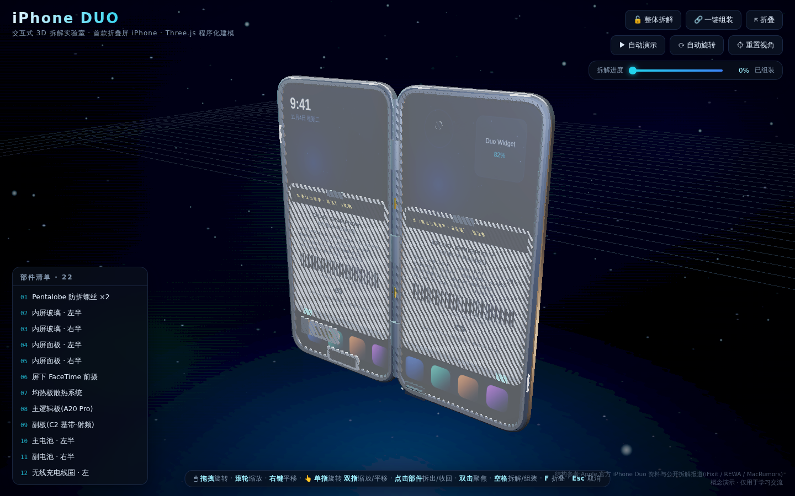
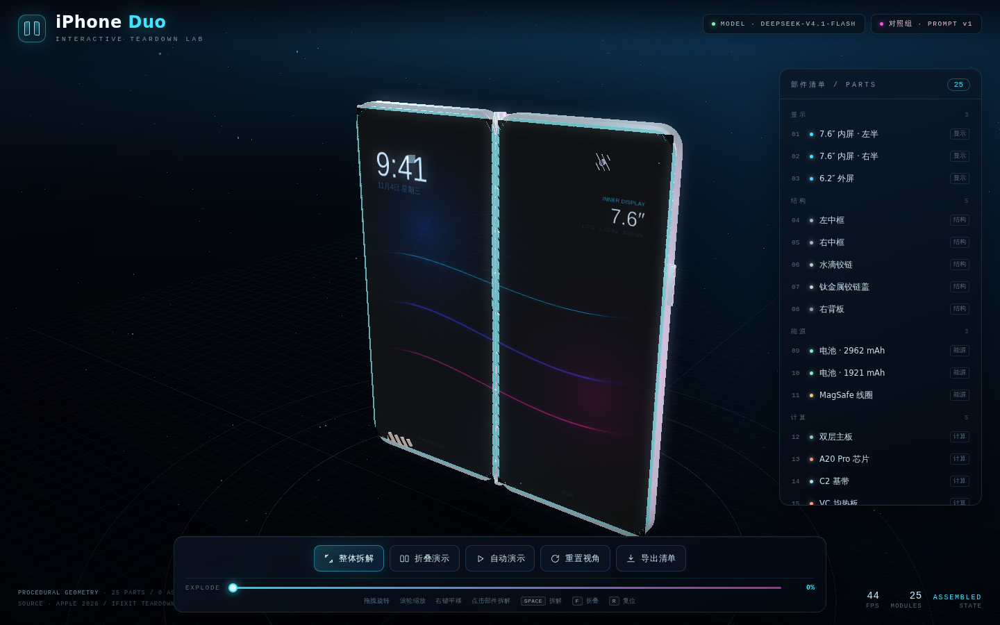
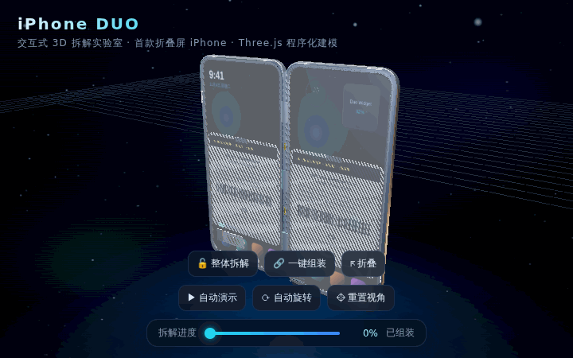
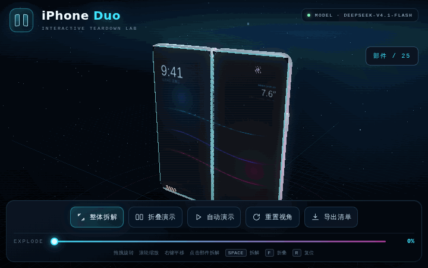

# iPhone Duo · 同提示词多模型对比实验室

用**同一份提示词**([PROMPT.md](PROMPT.md))让不同 AI 模型各自生成
「iPhone Duo 交互式 3D 拆解可视化」,汇总在同一仓库做横向对比。

`可运行 2/2` · `预览图自动生成` · `GitHub Pages 在线体验`

---

## 👀 效果预览

> 点图进入可交互版本;图片由 `npm run capture` 自动生成,规格见 [docs/shots/README.md](docs/shots/README.md)。

### 首屏渲染对比

| [](https://hflboy.github.io/iphone-duo-compare/models/glm-5.3/) | [](https://hflboy.github.io/iphone-duo-compare/models/deepseek-flash/) |
|:---:|:---:|
| **GLM-5.3-Flash** · 22 部件 · 折叠联动 | **DeepSeek-V4.1-Flash** · 25 部件 · 双级泛光 |

### 拆解过程对比

| [](https://hflboy.github.io/iphone-duo-compare/models/glm-5.3/) | [](https://hflboy.github.io/iphone-duo-compare/models/deepseek-flash/) |
|:---:|:---:|
| 电控脱胶把手 + 折叠联动拆解 | 双级泛光 + 折叠厚度补偿 |

> **为什么 README 里只能放图,不能直接跑 3D?**
> GitHub 会对 README 的 HTML 做白名单过滤:`<script>` / `<iframe>` / `<style>` 全被剔除,
> 所以交互式 Three.js 只能在真正的网页里跑。预览走「静态图 + 动图 + 跳转」组合,
> 体验走 GitHub Pages。

---

## 🚀 在线体验

| 入口 | 地址 |
|---|---|
| **并排对比页**(左右同屏交互) | https://hflboy.github.io/iphone-duo-compare/ |
| GLM-5.3-Flash | https://hflboy.github.io/iphone-duo-compare/models/glm-5.3/ |
| DeepSeek-V4.1-Flash | https://hflboy.github.io/iphone-duo-compare/models/deepseek-flash/ |

首次打开需要联网从 CDN 取 Three.js(各页面自带多级兜底);把 `three.min.js` 放进
`models/<id>/js/lib/` 即可完全离线。

---

## 目录结构

```
iphone-duo-compare/
├── README.md                本文件 · 对比总览
├── PROMPT.md                统一提示词原文 + 评测维度
├── index.html               Pages 首页:两模型并排 iframe 对比
├── package.json             预览图生成脚本依赖
├── upload-to-github.ps1     一键上传脚本(GitHub API,无需 git)
├── .github/workflows/
│   ├── capture.yml          models/ 变更或手动触发:CI 生成预览图并回提交
│   └── pages.yml            推 main 自动发布整站到 GitHub Pages
├── tools/
│   ├── serve.mjs            本地静态服务(预览用)
│   └── capture.mjs          无头浏览器截图 + 动图生成
├── docs/shots/              README 用的预览图(脚本产物)
└── models/
    ├── glm-5.3/             ← GLM-5.3-Flash 生成(完整可运行)
    │   ├── index.html
    │   ├── README.md
    │   └── js/ (partsData / phoneModel / bloom / controls / explode / main)
    └── deepseek-flash/      ← DeepSeek-V4.1-Flash 生成(对照组,完整可运行)
        ├── index.html
        ├── README.md
        └── js/ (data / textures / phone / bloom / controls / app)
```

---

## 对比总表

| 模型 | 状态 | 技术要点 | 亮点 | 待改进 |
|---|---|---|---|---|
| GLM-5.3-Flash | ✅ 可运行 | Three.js r128 UMD + 原生 JS;22 部件程序化建模;自研轨道控制器/泛光管线/拆解编排;折叠联动动画 | 零模型贴图全代码生成;真实拆解数据(2962+1921mAh 电控脱胶);自动演示模式;六级 CDN 兜底 | 首次打开需联网取 Three.js(可下载到 `js/lib/` 实现完全离线) |
| DeepSeek-V4.1-Flash | ✅ 可运行 | Three.js r128 UMD + 原生 JS;25 部件分层建模;自研轨道控制器/两级泛光;Canvas 程序化贴图;折叠厚度补偿;JSON 清单导出 | 25 个部件覆盖双屏/双电池/双摄/VC/铰链/胶条;12 张 Canvas 贴图;部件聚焦 + 呼吸高亮;拆解清单导出;六源加载兜底(本地 + 5 CDN) | 首次打开需联网取 Three.js;铰链为视觉简化运动学,保留 2.7° 折叠间隙;无真实阴影 |

## 实验记录

| 日期 | 模型 | 提示词版本 | 产物 | 备注 |
|---|---|---|---|---|
| 2026-11-04 | DeepSeek-V4.1-Flash | [`PROMPT.md`](PROMPT.md) v1(一字未改) | [`models/deepseek-flash/`](models/deepseek-flash/) | 25 部件 / 零外部资源 / 自带拆解清单导出 |

### 两组实现的快速对照

| 维度 | GLM-5.3-Flash | DeepSeek-V4.1-Flash |
|---|---|---|
| 部件数量 | 22 | 25 |
| 代码组织 | 6 个 JS 模块(partsData / phoneModel / bloom / controls / explode / main) | 6 个 JS 模块(data / textures / phone / bloom / controls / app) |
| 屏幕与折叠 | 内屏分半 + 折叠联动拆解 | 内屏分半 + 折叠厚度补偿 + 折叠时整机重新居中 |
| 高亮方式 | 自发光脉冲 + 描边 + 泛光 | 自发光脉冲 + 描边 + 跟随点光 + 泛光 |
| 交互面板 | 左侧部件列表 + 右侧信息卡 | 右侧分组部件清单 + 左侧信息卡 + 底部控制坞 |
| 附加功能 | 自动演示、折叠演示、进度滑杆 | 自动演示、折叠演示、进度滑杆、JSON 拆解清单导出 |
| 离线能力 | 需联网取 Three.js(可放 `js/lib/`) | 需联网取 Three.js(可放 `js/lib/`) |

> 两个项目均由各自模型在**同一份提示词**下独立生成,未共享实现代码;
> 本表只做客观罗列,评分请按 [`PROMPT.md`](PROMPT.md) 的评测维度自行横向体验。

---

## 预览图如何生成

```powershell
npm install
npx playwright install chromium
npm run capture              # 全部模型
npm run capture -- glm-5.3   # 只重跑一个
npm run serve                # 本地看效果 → http://127.0.0.1:4173/
```

脚本用无头 Chromium 打开每个 `models/<id>/index.html`,等 loader 消失后:
拍 1440×900 首屏 → 把拆解滑杆推到 100% 拍定格 → 以 800×500 逐帧推进滑杆合成 GIF。
全部输出在 `docs/shots/`,命名固定为 `<id>-cover.png` / `<id>-exploded.png` / `<id>-explode.gif`。

不想在本地装环境,也可以在 Actions 里手动跑 **capture-shots** 工作流,CI 会生成并提交回来。

### GitHub Pages

仓库是 public,Pages 走 **GitHub Actions** 发布(Settings → Pages → Source = `GitHub Actions`):

1. 每次 push 到 `main`,`pages.yml` 会打包仓库根目录并部署,无需手动操作;
2. 根目录 [`index.html`](index.html) 是并排对比页,`models/<id>/` 是各自的单页;
3. 部署历史在仓库的 Actions / Deployments 里可查。

> ⚠️ 站点地址按仓库 `hflboy/iphone-duo-compare` 预填;换账号或改名仓库时记得同步这几处链接。

---

## 如何添加新模型项目

1. 把 [PROMPT.md](PROMPT.md) 里的提示词原文交给目标模型(一字不改);
2. 将其生成的完整项目放入 `models/<模型名>/`;
3. 在 [tools/capture.mjs](tools/capture.mjs) 的 `TARGETS` 里加一条(id / entry / slider / loader);
4. 跑 `npm run capture -- <id>`,再在本 README 的预览表格与对比表里各追加一列/一行;
5. 重新运行上传脚本同步到 GitHub。

---

## 如何上传 / 更新到 GitHub

在 PowerShell 中运行(需要 GitHub 用户名与 Fine-grained PAT,
权限:`Contents: Read and write` + `Administration: Read and write` + `Workflows: Read and write`):

```powershell
cd D:\HFL\study\iphone-duo-compare
.\upload-to-github.ps1
```

- 无需安装 git(走 GitHub API 逐文件上传)
- 重复运行安全:已存在的文件自动按 sha 更新
- 自动跳过 `node_modules/`、`js/lib/`、`package-lock.json`;根目录、`tools/`、`docs/`、`.github/`、`models/` 全部同步
- ⚠️ Token 仅在本进程内使用,用完请到 GitHub 撤销
